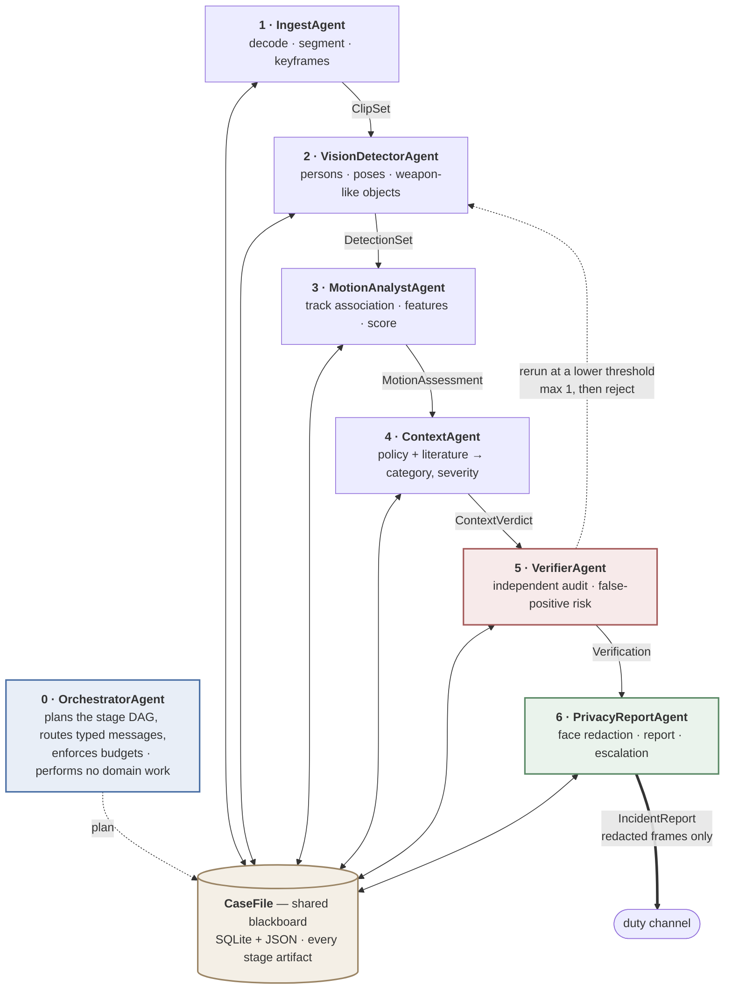

# SafeSchool — a multi-agent system for detecting safety violations in educational institutions

A team of seven agents that takes school surveillance footage and decides, with a
stated reason, whether what it sees is a safety violation — then redacts the faces
and escalates it to the right level.

Practical component of the master's thesis *"Computer Vision and Machine Learning
Models for Detecting Safety Violations and Child Abuse in Educational
Institutions"*, and the deliverable for Assignment 2 of the Artificial
Intelligence and Machine Learning course.

Stage 1 of the thesis was a systematic and bibliometric review of 50 papers
(2022–2026). Three findings from it are built into this design rather than left
as discussion:

| Review finding | How the system answers it |
|---|---|
| Privacy is absent from the technical discourse — 2 of 50 papers mention it | A dedicated agent owns face redaction and is the only component that touches identifiable imagery; the reasoning agents receive numbers and text only |
| Benchmarks are adult subjects in non-educational settings | A policy clause and a depth-aware stature check exist specifically for the adult-on-child case; the system reasons about *child* context explicitly |
| Accuracy and AUC dominate; false-alarm behaviour goes unreported | An independent verifier reports a false-positive risk on every alert, the scorer is interpretable rather than a black box, and benign-looking-violent scenarios are first-class test cases |

---

## Why a team of agents, not one

The subtasks have genuinely incompatible requirements, and two of them are
correctness properties that a single agent cannot provide:

| Subtask | Nature | Why it cannot share an agent |
|---|---|---|
| Decode and segment video | deterministic, I/O-bound, no language | spending tokens on it would make a reproducible step non-reproducible |
| Detect persons, poses, weapons | GPU-bound numeric model | its own batching and confidence thresholds; a perception failure must be distinguishable in the logs from a reasoning failure |
| Aggregate motion over tracks | numeric, temporal | a different failure mode again — missing tracks are not bad reasoning |
| Decide whether this is a *child-safety* violation | retrieval and reasoning over policy and literature | needs grounding, and must never see a face |
| Adjudicate false positives | adversarial self-critique | **an agent reviewing its own output inherits the assumption that produced the error.** Independence is the whole point |
| Redact and escalate | policy-bound, auditable | **exactly one place to audit for a privacy leak**, and one place where anything leaves the system |

The last two are the strongest argument. They are not an efficiency split; they
are structural guarantees that disappear the moment you merge the agents.

---

## Architecture

A pipeline of six workers, sequenced by a planning orchestrator, over a shared
case-file blackboard — the orchestrator, pipeline and shared-memory patterns
combined, each doing the part it is good at.



### The agent team

| # | Agent | Role | Input | Output | Tools (≤5) | Done when |
|---|---|---|---|---|---|---|
| 0 | `OrchestratorAgent` | Plans the stage sequence, routes messages, enforces budgets and re-runs. **No domain work.** | `CaseRequest` | `Plan` | case store, logger | the plan completed, or aborted with a stated reason |
| 1 | `IngestAgent` | Decode the video, segment into clips, extract keyframes | video path | `ClipSet` | `video.probe`, `video.extract_keyframes`, `fixtures.load` | ≥1 clip with a valid interval is registered |
| 2 | `VisionDetectorAgent` | Per-frame persons, 17-point poses, weapon-like objects | `ClipSet` | `DetectionSet` | `yolo.load_model`, `yolo.detect_poses`, `yolo.detect_objects`, `fixtures.load` | every clip has a detection record (empty is valid) |
| 3 | `MotionAnalystAgent` | Associate detections into tracks, compute features and a violence score | `DetectionSet` | `MotionAssessment` | `tracking.assign_ids`, `features.extract_features`, `features.score` | every clip has a score in [0,1] and its feature vector |
| 4 | `ContextAgent` | Interpret against school policy and the reviewed literature | `MotionAssessment` | `ContextVerdict` | `policy_kb.candidate_clauses`, `corpus_retriever.search`, `llm.complete_json` | a category, severity 1–4 and ≥1 citation |
| 5 | `VerifierAgent` | Independently audit the chain; accept / reject / re-run | `ContextVerdict` | `Verification` | `rules.consistency_checks`, `llm.complete_json`, `case_store.read_artifacts` | a verdict with confidence and an issue list |
| 6 | `PrivacyReportAgent` | Redact faces, write the report, escalate per policy | `Verification` | `IncidentReport` | `blur.redact_frame`, `policy_kb.escalation_tier`, `report.render`, `notifier.notify` | reports exist and reference only redacted frames |

Messages are pydantic models with `extra="forbid"`, serialized to JSON inside an
`AgentMessage` envelope. A typo'd field fails at the receiving boundary rather
than corrupting a later stage. Control metadata (a re-run's lowered threshold)
rides on the envelope, never inside a domain payload.

### External tools and data sources

1. **Anthropic Claude API** — the reasoning in agents 4 and 5
2. **Pretrained YOLOv8n / YOLOv8n-pose** — detection and pose estimation
3. **The thesis literature corpus** — 50 reviewed papers (`matrix_literature.csv` plus the extracted full texts), indexed with BM25 so verdicts cite published evidence
4. **School-safety policy knowledge base** — `data/policy/school_safety_policy.json`
5. **SQLite case store** — explicit, inspectable task state

---

## Quick start

```bash
git clone <this repo> && cd safeschool-agents
python3 -m venv .venv && .venv/bin/pip install -e ".[cv,dev]"
```

Runs with no API key and no model weights — it falls back to recorded fixtures
and a deterministic mock model, and says so in the output:

```bash
.venv/bin/python -m safeschool.cli demo
```

For real inference and real reasoning:

```bash
cp .env.example .env        # then put your key in it; .env is gitignored
.venv/bin/python scripts/fetch_samples.py
.venv/bin/python -m safeschool.cli run data/raw/corridor_people.mp4
```

### Commands

| Command | What it does |
|---|---|
| `safeschool run <video>` | run the pipeline on one clip |
| `safeschool demo` | run all 10 scenarios, check against expectations |
| `safeschool agents` | print the agent specification table |
| `safeschool scenarios` | list the scenarios and expected outcomes |
| `safeschool load [log]` | per-agent call share (the ≤40% check) |
| `safeschool cases` / `show <id>` | inspect stored case files |

`python tools/load_report.py --markdown 'logs/*.jsonl'` produces the
call-distribution table for the report, and exits non-zero if any agent is over
the limit.

---

## A run

```
  [ok ] tool  IngestAgent        fixtures.load                     0.3ms
  [ok ] agent IngestAgent        ingest                           45.6ms
  [ok ] tool  VisionDetectorAgent fixtures.load                    0.1ms
  [ok ] agent VisionDetectorAgent vision                           0.3ms
  [ok ] tool  MotionAnalystAgent features.extract_features         2.9ms
  [ok ] tool  MotionAnalystAgent features.score                    0.0ms
  [ok ] agent MotionAnalystAgent motion                            3.3ms
  [ok ] tool  ContextAgent       policy_kb.candidate_clauses       0.1ms
  [ok ] tool  ContextAgent       corpus_retriever.search           0.4ms
  [ok ] llm   ContextAgent       classify@mock-llm                 0.0ms
  [ok ] agent ContextAgent       context                          30.8ms
  [ok ] tool  VerifierAgent      case_store.read_artifacts         0.0ms
  [ok ] tool  VerifierAgent      rules.consistency_checks          0.0ms
  [ok ] llm   VerifierAgent      verify@mock-llm                   0.0ms
  [ok ] agent VerifierAgent      verify                            0.2ms
  [ok ] tool  PrivacyReportAgent blur.redact_frame                 2.0ms
  [ok ] tool  PrivacyReportAgent report.render                     0.0ms
  [ok ] tool  PrivacyReportAgent notifier.notify                   0.1ms
  [ok ] agent PrivacyReportAgent report                            5.6ms
  [ok ] system OrchestratorAgent  case_complete                    0.0ms

  tier      emergency
  category  adult_on_child_abuse (severity 4/4)
  summary   adult on child abuse (severity 4), motion score 0.91,
            verification accept with low false-positive risk
  privacy   6 face region(s) blurred across 3 frame(s)
  stages    ingest=done vision=done motion=done context=done verify=done report=done
```

### Load distribution — the ≤40% requirement

Measured from the logs of all 10 scenarios (`tools/load_report.py`):

| agent | tool calls | LLM calls | share |
|---|---:|---:|---:|
| `MotionAnalystAgent` | 61 | 0 | 25.5% |
| `VisionDetectorAgent` | 52 | 0 | 21.8% |
| `PrivacyReportAgent` | 40 | 0 | 16.7% |
| `IngestAgent` | 38 | 0 | 15.9% |
| `ContextAgent` | 16 | 8 | 10.0% |
| `VerifierAgent` | 16 | 8 | 10.0% |
| `OrchestratorAgent` | 0 | 0 | 0.0% |

Busiest agent 25.5% of 239 calls, against a 40% limit. The orchestrator sits at 0% because it
plans and routes and does nothing else — which is what the specification asks of
it, and the log is what proves it.

---

## Test scenarios

`safeschool demo` — 10/10 meet their stated expectations.

| scenario | input | expected | result |
|---|---|---|---|
| `corridor_walking` | real CCTV, people walking | no alert | `no_violation` / log |
| `crowded_aisle` | real CCTV, several people, confined space | no alert | `no_violation` / log |
| `single_person` | real CCTV, one person | no interaction verdict | `no_violation` / log |
| `empty_scene` | synthesized, no people | no alert | `no_violation` / log |
| `corrupt_file` | unreadable container | clean failure | `StageFailed`, readable message |
| `missing_file` | nonexistent path | clean failure | `StageFailed`, readable message |
| `fixture_fight` | recorded two-person fight | escalate | `physical_violence` / notify_admin |
| `fixture_weapon` | recorded, weapon-like object | emergency | `weapon_threat` / emergency |
| `fixture_adult_child` | recorded, large stature disparity | safeguarding | `adult_on_child_abuse` / emergency |
| `fixture_rough_play` | recorded, mutual energetic play | **no violence alert** | `bullying_nonphysical` / notify_staff |

The first four are the ones that matter most: they are real footage where the
correct behaviour is silence. A system that cannot stay quiet is not deployable
in a school.

`pytest` — 43 tests covering the message contract, budgets, loop protection,
retries, the re-run path, secret redaction, the Anthropic path (stubbed), and the
load limit.

---

## Reliability and safety

- **Budgets** — a step budget and a wall-clock deadline per case, checked before every agent runs.
- **Loop protection** — an agent receiving an identical input more than twice aborts the run. The Verifier gets at most one re-run; after that it must decide.
- **Retries** — three attempts with exponential backoff on recoverable errors; non-recoverable ones fail immediately instead of burning the budget.
- **Logging** — every agent, tool and LLM call is one JSONL line, written by the runtime so an agent cannot skip it. API keys and tokens are scrubbed before writing.
- **Secrets** — read from the environment or a gitignored `.env`; never in source, never in a log.
- **Fixture honesty** — a run backed by fixtures is marked `source="fixture"` in the payload and raises a `fixture_backed_run` issue in verification. It can demonstrate the pipeline; it can never be mistaken for a detection.
- **Privacy** — redaction failure withholds the frame rather than emitting it. Mosaic-then-blur, so there is nothing left to recover.

---

## Known limits

Honest ones, for the defence:

- **The violence scorer is a calibrated heuristic, not a trained model.** Interpretable weights over named features. It separates the scenarios here cleanly, but it has not been evaluated against a labelled benchmark. Training a temporal classifier on a child-specific dataset is the next stage; the interface (features in, score and rationale out) is designed not to change.
- **The positive scenarios run on synthesized fixtures.** Hockey Fights, RWF-2000 and UCF-Crime all require accepting dataset terms, so they are not redistributed here. `scripts/fetch_samples.py` prints the instructions for adding them.
- **Track association is greedy IoU matching**, adequate for short clips and a handful of people, not for a crowded hall.
- **Separating rough play from a real fight is genuinely hard from motion alone** — the review found this to be the dominant false-positive class. The policy clauses and the LLM context stage carry that judgement; the geometry alone does not settle it.
- **The policy knowledge base is illustrative**, written from the review's safeguarding categories. A deployment would need the institution's actual policy.

## Repository layout

```
src/safeschool/
  messages.py     the inter-agent contract      runtime.py    budgets, retries, loop guard
  state.py        CaseFile blackboard + store   logging_bus.py  JSONL call log
  llm.py          Anthropic + mock fallback     pipeline.py   one entry point
  config.py       settings and secrets          scenarios.py  tests with expectations
  agents/         one module per agent          tools/        the seven tools
docs/             architecture (EN + RU), rubric map
fixtures/         recorded scenarios + synthetic keyframes
scripts/          fetch_samples.py, make_fixtures.py
tools/            load_report.py
tests/            43 tests
```

## Licence and intent

Research prototype for a master's thesis. It produces advisory output for human
review; nothing here should act on a child without a person in the loop.
