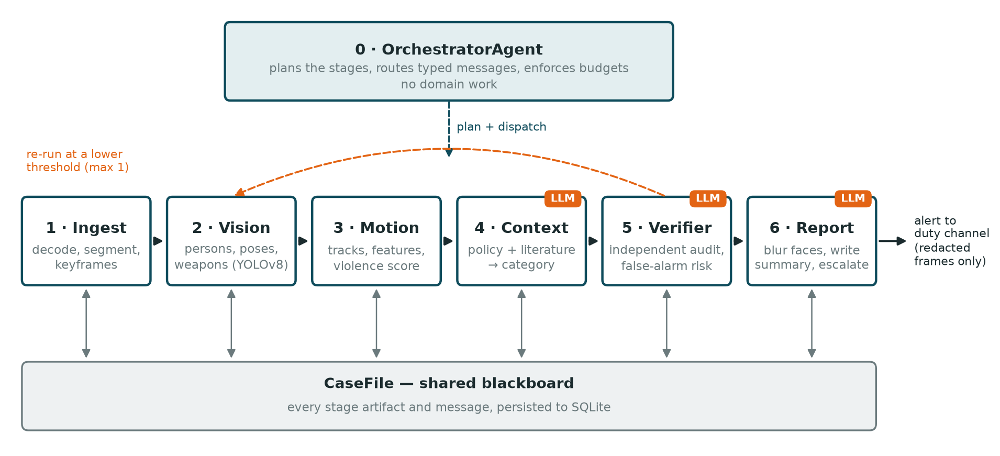
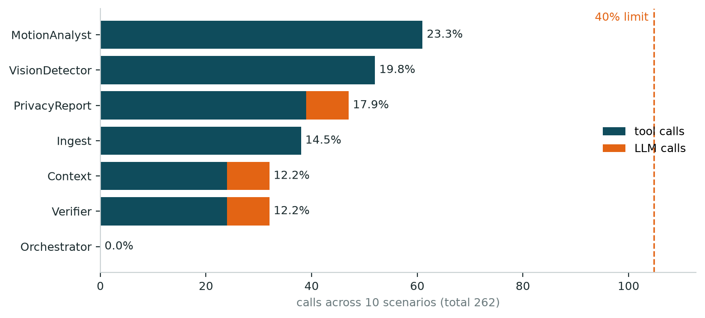

**Source code:** <https://github.com/marioscordia/multi-agent>

## 1. Introduction

Schools increasingly have CCTV, but nobody watches it live. A fight in a corridor,
a weapon on the playground or an adult handling a child roughly is usually found
after the fact, if at all. This project builds **SafeSchool**, a multi-agent AI
system that takes school surveillance footage and decides, with a stated reason,
whether what it sees is a safety violation. It then blurs every face and alerts
the right person at the right level of urgency.

The project is the practical component of the master's thesis *"Computer Vision
and Machine Learning Models for Detecting Safety Violations and Child Abuse in
Educational Institutions"*. Stage 1 of the thesis was a systematic and
bibliometric review of 50 papers published in 2022–2026. Three of its findings
shaped this design directly:

| Review finding | How the system responds |
|---|---|
| Privacy is almost absent from the technical literature: 2 of 50 papers mention it | One dedicated agent owns face redaction and is the only component that touches images; the reasoning agents receive numbers and text only |
| Benchmarks use adult subjects in non-school settings | A policy clause and a depth-aware body-size check exist specifically for the adult-on-child case |
| Accuracy dominates; false-alarm behaviour goes unreported | An independent verifier reports a false-alarm risk on every decision, the violence scorer is interpretable, and "looks violent but is not" scenarios are first-class test cases |

The system output is advisory. Nothing in it acts on a child without a person in
the loop, and every report says so.

## 2. Why a team of agents, not one

The work divides into subtasks with incompatible requirements: deterministic video
decoding, GPU-bound object detection, numeric motion analysis, language-based
reasoning over policy and literature, adversarial review, and privacy-bound
reporting. A single agent could be prompted to do all of it, but two properties
of the system cannot exist without separate agents:

1. **Independent verification.** An agent that reviews its own conclusion
   inherits the assumption that produced the error. The VerifierAgent sees only
   what each stage produced, holds no stake in the verdict, and is the only agent
   allowed to send the case back for another look.
2. **A single privacy boundary.** Exactly one agent opens image files and exactly
   one agent sends anything out of the system. That makes the privacy guarantee
   auditable in one place, which is precisely the gap the literature review found.

The other splits follow failure modes. A perception failure (a missed person)
must be distinguishable in the logs from a reasoning failure (a wrong
interpretation), and a deterministic step such as decoding must stay
reproducible rather than depend on a model's answer.

## 3. Architecture

The system combines three of the interaction schemes named in the assignment:

- **Pipeline:** the stages have a real data dependency. Motion cannot be measured
  before people are detected, and policy cannot be applied before there is a score.
- **Orchestrator:** one agent owns the plan, the budgets and the single
  control-flow decision (whether to re-run). It performs no domain work.
- **Shared memory (blackboard):** a `CaseFile` holds every stage's output, so the
  Verifier can audit the whole chain and the report can draw on all of it without
  every agent being wired to every other.

Hierarchy is deliberately not used: with six stages in a linear order, a tree of
sub-agents would add indirection and nothing else.



*Figure 1. SafeSchool architecture. Solid arrows are typed messages (ClipSet, DetectionSet, MotionAssessment, ContextVerdict, Verification); every agent reads and writes the shared CaseFile; the orange badge marks the three agents that call the language model.*

## 4. The agents

Seven agents: one orchestrator and six workers. Each owns one stage and no two
share a role. Every agent declares its role, input and output message types, its
tools and its completion criterion in code, and `safeschool agents` prints this
table from the live classes.

| # | Agent | Role | Input → Output | Tools (≤5) | Done when |
|---|---|---|---|---|---|
| 0 | Orchestrator | plan the stages, route messages, enforce budgets and the re-run | CaseRequest → Plan | case store, logger | the plan completed or aborted with a stated reason |
| 1 | Ingest | decode the video, cut it into clips, extract keyframes | CaseRequest → ClipSet | video.probe, video.extract_keyframes, fixtures.load | ≥1 clip with a valid interval |
| 2 | Vision | detect persons, 17-point poses and weapon-like objects | ClipSet → DetectionSet | yolo.load_model, yolo.detect_poses, yolo.detect_objects, fixtures.load | every clip has a detection record |
| 3 | Motion | link detections into tracks, compute features and a violence score | DetectionSet → MotionAssessment | tracking.assign_ids, features.extract_features, features.score | every clip has a score in [0, 1] |
| 4 | Context | interpret the motion against school policy and the literature | MotionAssessment → ContextVerdict | policy_kb.candidate_clauses, corpus_retriever.search, evidence.summarize, llm.complete_json | category, severity 1–4, ≥1 citation |
| 5 | Verifier | independently audit the chain: accept, reject or re-run | ContextVerdict → Verification | rules.consistency_checks, case_store.read_artifacts, evidence.summarize, llm.complete_json | verdict with confidence and issue list |
| 6 | Report | blur faces, write the report and staff summary, escalate | Verification → IncidentReport | blur.redact_frame, policy_kb.escalation_tier, llm.complete_json, report.render, notifier.notify | reports exist and reference only redacted frames |

**Where the language model is used.** Three agents call Claude (model
`claude-sonnet-5-5`), each for a different language task: the ContextAgent
classifies the incident, the VerifierAgent audits that classification, and the
PrivacyReportAgent turns the technical verdict into a short message a teacher can
act on. The other four agents do deterministic or numeric work (decoding, a
local YOLOv8 model, geometry, routing), where a language model would add cost,
latency and non-reproducibility without adding capability. The assignment
defines an agent by its role, inputs, outputs, tools and completion criterion,
not by the use of an LLM.

Two limits keep the model in its place. In the ContextAgent the answer is
constrained to the policy categories that apply to the case, so the model cannot
invent a label. In the PrivacyReportAgent the alert level is fixed by policy
*before* the model is called; the model writes text and cannot change who is
alerted.

## 5. Communication and state

**Typed messages.** Agents never exchange raw dictionaries. Every payload is a
pydantic model with `extra="forbid"`, carried inside an `AgentMessage` envelope
(sender, recipient, type, attempt, causation id). The receiving agent validates
the payload against its declared input type before doing any work, so a
contract violation fails at the hand-off rather than three stages later.

**Control data is kept apart from domain data.** When the Verifier asks for a
re-run at a lower detection threshold, that threshold describes the process, not
the incident. It travels in the envelope's `overrides` field. An early version
put it inside the `ClipSet` payload, the strict schema rejected it, and the
re-run path did not work until the two were separated.

**Size profile of one case.** The detection message is about 10 KB, roughly twenty
times larger than any other, because it carries every box and keypoint. The
MotionAnalystAgent's job is to collapse that into meaning: a 0.7 KB assessment
with named features and a score. The language-model agents only ever see the
small summary, which keeps them fast and cheap and keeps images out of prompts.

**Explicit state.** The `CaseFile` blackboard records every artifact, every
message and every note, and is persisted to SQLite after each stage.
`safeschool show <case_id>` prints the full state of any past case.

**The one loop.** The Verifier may return `rerun`. The orchestrator then resets
the vision-to-verify stages and runs them again with the lowered threshold. This
can happen at most once; after that the Verifier must accept or reject and the
report states why no further attempt was made.

## 6. Tools and data sources

The assignment asks for at least two external tools or data sources; the system
uses five:

1. **Anthropic Claude API:** classification, verification and the staff summary.
2. **Pretrained YOLOv8n and YOLOv8n-pose:** person, pose and object detection, run locally.
3. **The thesis literature corpus:** the 50 reviewed papers, indexed with BM25 so
   every verdict cites published evidence. BM25 was chosen over embeddings because
   the corpus is small, the index builds in 0.04 s, and lexical matches are explainable.
4. **A school-safety policy knowledge base:** six clauses with categories,
   severities, indicators and the required response.
5. **A SQLite case store:** explicit, inspectable task state.

A sixth internal tool, `evidence.summarize`, was added during testing (section 9):
it gives the reasoning agents a per-person summary, weapon facts and a guide to
reading the motion features.

## 7. Reliability and safety

| Concern | Mechanism |
|---|---|
| Runaway runs | step budget (40) and wall-clock deadline (300 s) per case, checked before every agent |
| Agents looping | the same agent receiving an identical input more than twice aborts the run |
| Re-run cycles | at most one re-run; then the Verifier must decide |
| Transient failures | 3 attempts with exponential backoff; non-recoverable errors fail at once |
| Bad model output | answers constrained to a JSON schema; cut-off answers retried; categories outside the allowed set fall back to the policy rule |
| Model refusal | the API retries on a fallback model; if the chain still refuses, the policy rule decides and the log says so |
| Readable failure | a failed case ends with a stated stage, agent and reason (`corrupt_file` and `missing_file` scenarios) |
| Logging | every agent, tool and LLM call is one JSONL line, written by the runtime so an agent cannot skip it |
| Secrets | the API key is read from the environment or a gitignored `.env`, never stored in code, and scrubbed from logs |
| Privacy | faces are blurred (mosaic, then blur) before any frame leaves the system; a redaction failure withholds the frame |

The step limit, loop guard, retry path and secret scrubbing each have unit tests.

## 8. Evaluation

### 8.1 Test scenarios

Ten scenarios, each with a stated expected outcome, run end to end with the real
model (`safeschool demo`):

| Scenario | Input | Expected | Result |
|---|---|---|---|
| corridor_walking | real CCTV, people walking | no alert | no violation / log ✓ |
| crowded_aisle | real CCTV, confined space | no alert | no violation / log ✓ |
| single_person | real CCTV, one person | no interaction verdict | no violation / log ✓ |
| empty_scene | empty corridor | no alert | no violation / log ✓ |
| corrupt_file | unreadable video | clean failure | failed with a stated reason ✓ |
| missing_file | nonexistent path | clean failure | failed with a stated reason ✓ |
| fixture_fight | one-sided fight | violence alert | physical violence / notify admin ✓ |
| fixture_weapon | knife held in a hand | emergency | weapon threat / emergency ✓ |
| fixture_adult_child | adult dragging a child | safeguarding | adult-on-child abuse / emergency ✓ |
| fixture_rough_play | mutual play, onlooker | no violence alert | non-physical bullying (low) / log ✓ |

**10 of 10 met their expectations** with `claude-sonnet-5-5`, and 10 of 10 in the
offline mock mode. The four real-footage cases are the ones that matter most in
practice: the correct behaviour is silence, and a system that cannot stay quiet
is not deployable in a school.

In addition, **50 unit tests** cover the message contract, budgets, loop
protection, retries, the re-run path, refusal handling, the privacy rules for
prompts, and the load limit.

### 8.2 Load distribution

The assignment limits any agent to 40% of all LLM and tool calls. Measured from
the logs of the full real-model run:



*Figure 2. Calls per agent across the ten scenarios (262 in total). The busiest agent, MotionAnalyst, holds 23.3%; the orchestrator holds 0% because it only plans and routes.*

| Agent | Tool calls | LLM calls | Share |
|---|---:|---:|---:|
| MotionAnalyst | 61 | 0 | 23.3% |
| VisionDetector | 52 | 0 | 19.8% |
| PrivacyReport | 39 | 8 | 17.9% |
| Ingest | 38 | 0 | 14.5% |
| Context | 24 | 8 | 12.2% |
| Verifier | 24 | 8 | 12.2% |
| Orchestrator | 0 | 0 | 0.0% |

The balance was not automatic. An early version ran YOLO once per frame, which
put the VisionDetectorAgent at 77% of all calls. Batching inference per clip
brought it to 33%, and moving identity tracking from the vision agent to the
motion agent, where temporal reasoning belongs, settled the current distribution.
The role boundary and the load balance turned out to be the same decision.

### 8.3 Quality of the model's reasoning

The model's explanations cite the evidence it was given. For the fight it
reported contact in 100% of frames, a mean speed of 0.60 against a walking
baseline of 0.20, and a one-sided pattern in which one person repeatedly extends
an arm while the other never does. For the empty corridor it noted that all
features were zero and the evidence was too weak for any alert. The staff
summaries are 38–51 words, in plain language, and each states the confidence and
that a person must check the footage first.

## 9. Architectural decisions and what testing revealed

The most useful result of the project came from switching from the mock model to
the real one.

**The mock hid a data problem.** In mock mode the reasoning agents follow fixed
rules, and all ten scenarios passed. With the real model only seven did: the
fight, weapon and adult-child cases were all classified as harmless play. The
model's reasoning showed why. The synthetic fight moved *slower* than people
walking in the real corridor footage (speed 0.08 against 0.20), and the high
violence score came only from two saturated features. The model was right; the
test data was wrong. The fixtures were rebuilt and calibrated against the
measured walking baseline, and the reasoning agents were given a reading guide
for the features and a per-person summary. Lesson: a deterministic mock confirms
the plumbing, not the judgement.

**Error costs are not symmetric.** The original prompt told the model to prefer
the benign category whenever evidence was weak, to avoid false alarms. That rule
also suppressed a knife detected in a hand. The prompts now ask the model to
weigh both errors and not to dismiss strong, specific evidence, while the
Verifier checks in both directions: an unjustified alert and an unjustified
dismissal.

**A dismissal must not be silently buried.** When the Verifier rejected a
"harmless" verdict, the report logic treated the rejection as "no alert". It now
sends such cases to staff for review.

**Structured output beats repair.** The Verifier occasionally returned malformed
JSON, which the retry loop absorbed at the cost of a minute per case. Moving to
schema-constrained output removed the failure class entirely.

**Interpretable scoring paid off.** The violence score is a logistic
combination of eight named features with documented weights. Three weights encode
mistakes found on real footage: proximity uses the *median* closest distance,
because one person walking past another drove the minimum to zero; the limb
extension feature excludes ankles, which otherwise measured "has legs"; and
crowding has a negative weight, because a busy corridor is normal. A black-box
score would have given the Verifier nothing to audit.

**Perspective is not age.** The first adult-on-child check compared the tallest
and shortest person in frame and raised an emergency on supermarket CCTV, where a
shopper near the lens is twice the height of one further away. The check now
compares only the closest interacting pair, and only when their feet are at a
similar image height, which on a ground plane means a similar distance from the
camera.

## 10. Limitations

- **The violence scorer is a calibrated heuristic, not a trained model.** It
  separates the scenarios here but has not been evaluated on a labelled
  benchmark. Its interface (features in, score and rationale out) is designed so a
  trained temporal classifier can replace it.
- **The positive scenarios use synthetic detections.** Fight benchmarks such as
  RWF-2000 and UCF-Crime require accepting dataset terms and cannot be
  redistributed. Every such run is marked as test data in the payload, the
  verification and the staff summary.
- **Tracking is greedy box matching**, adequate for short clips and a few people,
  not for a crowded hall.
- **Rough play versus a fight is hard from motion alone.** The review found this
  to be the dominant false-alarm class; here the policy and the model carry that
  judgement.
- **Latency.** Each model call takes 3 to 6 seconds, so a case takes 11 to 18
  seconds (median 13). That suits review shortly after an event, not real-time
  intervention.
- **The policy is illustrative,** written from the review's safeguarding
  categories; a deployment would need the institution's own policy.

## 11. Conclusion

SafeSchool meets the specification: seven agents with distinct roles and at most
five tools each, typed messages, a shared persisted state, five external tools
and data sources, step, time and loop limits, retries, full call logging, and no
secrets in code. The busiest agent holds 23.3% of calls, and all ten scenarios
pass with the real model.

The multi-agent structure earned its place in two ways that a single agent could
not provide: an independent verifier that caught both false alarms and false
dismissals, and a single, auditable privacy boundary. The most instructive
finding was methodological: testing with the real model exposed weak test data
that a deterministic mock had accepted without complaint.

Next steps: replace the heuristic scorer with a temporal classifier trained on
child-specific data, add licensed real footage for the violence scenarios, and
run the reasoning agents in parallel to cut latency.

## Appendix: running the system

The full source code, tests and documentation are at
<https://github.com/marioscordia/multi-agent>.

```bash
git clone https://github.com/marioscordia/multi-agent.git && cd multi-agent
python3 -m venv .venv && .venv/bin/pip install -e ".[cv,dev]"
cp .env.example .env            # add ANTHROPIC_API_KEY; without it the mock is used
.venv/bin/python -m safeschool.cli demo          # 10 scenarios
.venv/bin/python -m safeschool.cli agents        # the agent table
.venv/bin/python tools/load_report.py --markdown 'logs/*.jsonl'
.venv/bin/python -m pytest -q                    # 50 tests
```

Results are written to `data/cases/<case_id>/report.md` (with redacted keyframes),
`data/channel/alerts.jsonl` and `logs/*.jsonl`; see `docs/RESULTS.md`.
