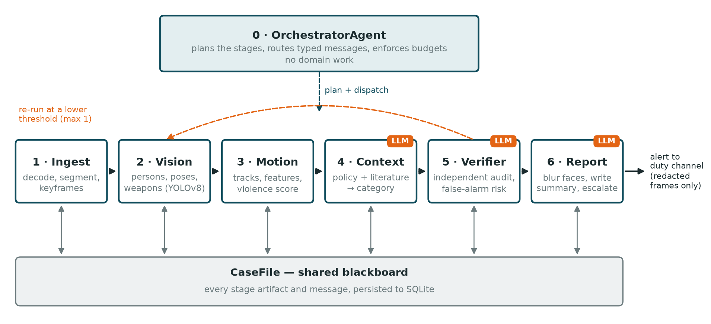
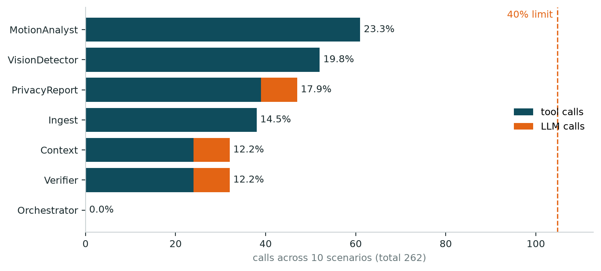

# SafeSchool: A Multi-Agent System with Independent Verification and a Single Privacy Boundary for Detecting Safety Violations in Educational Institutions

::: {custom-style="Author"}
Akhmetov Medet
:::

## Abstract

Video analytics for school safety is usually built as a single model that maps footage to a label, yet the literature on the problem rarely addresses privacy or reports how often such systems raise false alarms. This paper presents SafeSchool, a multi-agent system that takes school surveillance footage, decides with a stated reason whether it shows a safety violation, redacts every face and escalates the case to the appropriate person. Seven agents share the work: an orchestrator that only plans and routes, and six workers for video ingestion, person and pose detection, motion analysis, policy interpretation, independent verification and privacy-preserving reporting. Three of them call a large language model (Claude) for judgement and language; the remaining four do deterministic or numeric work. The agents exchange schema-validated messages and share a persisted case file, and the runtime enforces step, time and loop limits, retries and complete call logging. On ten test scenarios with stated expectations, including four real CCTV clips on which the correct behaviour is to raise no alert, the system met every expectation with the real model and with an offline mock. The busiest agent performed 23.3 % of the 262 tool and model calls, below the 40 % limit set by the specification, and a full case took 11 to 18 s. The most instructive result was methodological: the mock passed all scenarios from the start, whereas the real model initially passed only seven, because it correctly rejected synthetic fight data that moved more slowly than people walking in the real footage. The paper argues that two properties of the design, an independent verifier and a single auditable privacy boundary, are structural and could not be obtained from a single agent.

::: {custom-style="Keywords"}
**Keywords:** multi-agent systems, large language models, video surveillance, violence detection, child safeguarding, privacy, school safety
:::

## 1. Introduction

Schools increasingly record what happens in their corridors and playgrounds, but almost nobody watches the recordings as they are made. A fight in a corridor, a weapon on the premises or an adult handling a child roughly is typically discovered after the fact, if it is discovered at all. Automated analysis of surveillance video promises to close this gap, and a substantial body of work now applies deep learning and computer vision to violence and weapon detection, including in educational settings {perseghin} {kozham} {omarov}.

A systematic and bibliometric review of 50 studies published between 2022 and 2026, carried out as the first stage of this research {own}, found three recurring weaknesses in that literature. First, privacy is almost absent from the technical discussion: only 2 of the 50 papers address it, although the footage shows children and is among the most sensitive data a school holds. Second, the benchmarks are dominated by adult subjects in non-school settings, so the case that matters most in a school, an adult acting physically on a child, is rarely modelled explicitly. Third, papers report accuracy and area under the curve, while false-alarm behaviour, which determines whether staff will keep trusting an alerting system, goes largely unreported.

These weaknesses are hard to address inside a single end-to-end model. A system that is to protect privacy needs one place where identifiable images are handled and one place where anything leaves the system. A system that is to control false alarms needs a check that does not share the assumptions of the component it checks. A system that is to reason about a child-specific category needs a stage that can relate measurements to a written policy. Recent work on agents built around large language models (LLMs) offers a way to structure such a system as a team of components with separate roles {guo} {wu} {hong}, and older work on multi-agent systems and blackboard architectures provides the coordination patterns {wooldridge} {hayesroth}.

The research problem of this paper is therefore stated as follows: how should the task of detecting safety violations in school footage be divided among cooperating agents so that the resulting system protects privacy structurally, controls false alarms through independent verification, keeps the computational load balanced across agents and remains reliable when one of its components fails or misbehaves?

The paper makes four contributions. It presents the design of a seven-agent system in which the division of roles follows failure modes and correctness properties rather than convenience. It shows how a language model can be confined to the tasks that need judgement or language, with constraints that prevent it from inventing a category or changing who is alerted. It reports an evaluation on ten scenarios with stated expectations, including real footage on which the correct outcome is silence, together with a measured distribution of work across the agents. Finally, it documents a methodological finding that is relevant beyond this system: testing with a deterministic mock confirmed that the components were connected correctly but concealed that the test data were unrealistic, which only the real model exposed.

The remainder of the paper is organised as follows. Section 2 reviews related work. Section 3 describes the architecture, the agents, their communication and the evaluation protocol. Section 4 presents the results, Section 5 discusses them, Section 6 lists the limitations and Section 7 concludes.

## 2. Literature Review

Vision-based violence detection has moved from hand-crafted motion descriptors to deep spatiotemporal models. Early work on the Hockey Fights dataset used local motion features and bag-of-words classifiers {hockey}, and large benchmarks such as UCF-Crime {sultani} and RWF-2000 {rwf} later supported convolutional and recurrent architectures trained end to end. Within educational settings, Perseghin and Foresti built a lightweight prototype for violent action detection in Italian public schools {perseghin}, Kozhamkulova et al. used MoveNet pose estimation for fast detection of physical bullying {kozham}, Omarov et al. proposed a skeleton-based approach for campus violence {omarov}, and Ha et al. combined violence region localization with classification of school violent actions {ha}. Skeleton-based methods are attractive because they reduce a frame to body keypoints, which is cheaper and less identifying than raw pixels; Garcia-Cobo and SanMiguel showed that human skeletons combined with change detection support efficient violence detection in surveillance video {garcia}. Qi et al. extended the task from clip classification to temporal localization of fistfights {qi}, and Ali et al. released CABAD, a dataset for benchmarking child aggression recognition {ali}, which addresses part of the adult-subject bias noted above.

Weapon detection forms a related line of work. Tapia León et al. described an early warning system for firearm detection on university campuses based on convolutional networks and YOLO {tapia}, Berardini et al. ran handgun and knife detection on edge devices for indoor surveillance cameras {berardini}, and Da Silva and Pereira evaluated methods for both violence classification and firearm detection in indoor CCTV environments {dasilva}. Most of these systems rely on single-stage detectors of the YOLO family {yolo} {yolov8}, and pose estimation is usually based on the 17-keypoint COCO skeleton {coco}.

Across this literature, the system is typically a single model, and its output is a label or a score. The review that precedes this paper {own} found that design decisions about what happens after detection, such as who is alerted, how a false alarm is caught and how the footage is protected, are rarely part of the published system. This is the gap that motivates a multi-agent design.

Multi-agent systems have a long history in artificial intelligence. Wooldridge defines an agent as a computer system that is situated in an environment and is capable of autonomous action in it to meet its design objectives, and multi-agent systems as collections of such agents that interact {wooldridge}. The blackboard architecture, in which independent knowledge sources cooperate by reading from and writing to a shared data structure under the control of a scheduler, was developed for problems where no single source of expertise suffices {hayesroth}. Both ideas have returned in systems built around LLMs. Surveys of LLM-based multi-agent systems describe teams of role-specialised agents that communicate in natural language or structured messages {guo}. AutoGen provides a framework for applications composed of conversing agents {wu}, MetaGPT encodes standard operating procedures as roles in a software team {hong}, and ReAct interleaves reasoning with tool use inside one agent {yao}.

Two findings from this literature bear directly on the present design. Huang et al. showed that LLMs often fail to correct their own reasoning without external feedback, and that self-correction can even degrade performance {huang}. Du et al., in contrast, found that factuality and reasoning improve when several model instances debate and critique one another {du}. Together these results support separating the component that reaches a conclusion from the component that checks it. The second finding concerns the form of communication: structured, schema-constrained outputs remove a whole class of parsing failures that free-text exchange between agents is prone to {anthropic}.

The gap addressed by this paper is therefore twofold. On the application side, published school safety systems are single models whose privacy handling and false-alarm behaviour are not part of the design. On the systems side, LLM-based multi-agent frameworks are general purpose, and there is little guidance on how to divide a perception-heavy safety task among agents, which parts should and should not use a language model, and how to verify the resulting system.

## 3. Materials and Methods

SafeSchool processes one video, called a case, at a time. Its architecture, shown in Figure 1, combines three of the coordination schemes discussed above. The stages form a pipeline, because they have a genuine data dependency: motion cannot be measured before people are detected, and a policy cannot be applied before there is a score. An orchestrator owns the plan, the resource budgets and the single control-flow decision in the system, which is whether to repeat part of the pipeline. A shared case file acts as a blackboard {hayesroth}: every stage writes its output there, so that the verifier can audit the whole chain and the report can draw on all of it without every agent being connected to every other. A hierarchy of sub-agents was considered and rejected, since six stages in a linear order would gain indirection and nothing else.

{width=16cm}

The system consists of seven agents, listed in Table 1. Each owns exactly one stage, and every agent declares in code its role, its input and output message types, its tools and its completion criterion. The specification limits an agent to five tools, and this limit is enforced when an agent class is defined, so a violation is an error at import time rather than a finding in review.

Table: Table 1. The agents, their messages and tools

| Agent | Role | Input → output | Tools | LLM |
|---|---|---|---|---|
| Orchestrator | plans the stages, routes messages, enforces budgets and the re-run | case request → plan | case store, logger | no |
| Ingest | decodes the video, cuts it into clips, extracts keyframes | case request → clip set | video probe, keyframe extraction, fixture loader | no |
| Vision detector | detects persons, 17-point poses and weapon-like objects | clip set → detection set | model loader, pose detection, object detection, fixture loader | no |
| Motion analyst | links detections into tracks, computes features and a violence score | detection set → motion assessment | track assignment, feature extraction, scoring | no |
| Context | interprets the motion against school policy and the literature | motion assessment → context verdict | policy clauses, literature search, evidence summary, LLM | yes |
| Verifier | audits the chain and accepts, rejects or requests one re-run | context verdict → verification | consistency rules, case store, evidence summary, LLM | yes |
| Privacy report | blurs faces, writes the report and staff summary, escalates | verification → incident report | face redaction, escalation tier, LLM, report rendering, notifier | yes |

The ingest agent decodes the video with OpenCV, divides it into clips of 2 s, keeps at most six clips and samples every third frame. The vision detector runs the pretrained YOLOv8n and YOLOv8n-pose models {yolov8} locally, which return person boxes, the 17 COCO keypoints {coco} and objects such as knives. The motion analyst first associates detections across frames into tracks by greedy matching of box overlap, in the spirit of simple online tracking {sort}; identity tracking was placed in the motion agent rather than the vision agent because linking detections over time is temporal reasoning, while perception should remain per frame. It then computes nine named features for each clip: mean and peak speed in body lengths per second, speed variance, minimum and median distance between the closest pair of people, the share of frames in contact, peak limb extension, left-right pose asymmetry and crowding. The violence score is a logistic combination of these features,

$$s(\mathbf{x}) = \frac{1}{1 + \exp\left(-\left(b + \sum_{i} w_i f_i(\mathbf{x})\right)\right)},$$

where $f_i$ are the features, $w_i$ their documented weights and $b = -2.9$. The largest weights are given to the contact ratio (2.6) and limb extension (1.8), and crowding has a negative weight (-0.9), because a busy corridor is ordinary school movement. An interpretable scorer was chosen deliberately over a trained black box: every score can be explained by naming the three features that contributed most, which gives the verifier and the report something to audit.

The context agent turns the score into a decision. A school safety policy knowledge base with six clauses (physical violence, weapon threat, adult-on-child abuse, non-physical bullying, rough play and ordinary movement) defines categories, severities from 1 to 4, observable indicators and the required response. The agent first selects the clauses that can apply to the case, for example adding the weapon clause only if a weapon-like object was detected and the adult-on-child clause only if the closest interacting pair differs markedly in body size at equal depth. It retrieves supporting passages from the 50 papers of the literature review with a BM25 index {bm25}, and it builds an evidence summary that reports, for each tracked person, their mean speed, how often an arm was extended and their net movement, together with the confidence of any weapon detection and whether the object lies at a person's wrist. The language model then chooses one category and severity. Its answer is constrained by a JSON schema in which the category field may only take the values of the selected clauses {anthropic}, so the model cannot invent a label. The prompt contains numbers and text only; no frame, crop or file path reaches the model.

The verifier audits the chain in two layers. Eight deterministic rules run first and cannot be argued with, for example that a violence category requires at least two people, that a weapon category requires a weapon detection and that a high severity requires a score above the threshold. A second language-model call then reviews the evidence in both directions, looking for an alert that the evidence does not justify and for a dismissal that overlooks strong evidence. The model may add issues or lower confidence, but it cannot override a blocking rule. The verifier is the only agent that can alter the flow: it may request one repetition of the vision-to-verification stages with a lower detection threshold, after which it must accept or reject.

The privacy report agent is the only component that opens image files and the only one that sends anything out. It blurs faces on the keyframes by downsampling to a coarse mosaic and then blurring, and if redaction fails it withholds the frame rather than emitting it. The escalation tier (log, notify staff, notify administrator or emergency) is decided by the policy before the language model is called. The model then writes a short plain-language summary and one sentence on what the reader should do; it receives the decision, the reasoning and the policy text, but cannot change the tier. If the model fails or declines, a fixed template is used, so a report is never lost because its summary could not be written.

Agents never exchange free-form dictionaries. Every payload is a typed model with unknown fields forbidden, wrapped in an envelope that records the sender, recipient, message type, attempt number and causing message. The receiving agent validates the payload against its declared input type before doing any work, so a broken contract fails at the hand-off rather than several stages later. Control data, such as the lowered threshold of a re-run, travels in a separate field of the envelope, never inside the payload that describes the incident. The case file records every artifact, message and note and is saved to an SQLite database after each stage.

Reliability is implemented once, in the runtime that all agents share, rather than in each agent. Table 2 lists the mechanisms.

Table: Table 2. Reliability and safety mechanisms of the runtime

| Concern | Mechanism |
|---|---|
| Runaway runs | a budget of 40 steps and 300 s per case, checked before every agent |
| Loops between agents | the same agent receiving an identical input more than twice aborts the case |
| Re-run cycles | at most one re-run, after which the verifier must decide |
| Transient failures | three attempts with exponential backoff; non-recoverable errors fail at once |
| Malformed model output | answers constrained to a JSON schema; cut-off answers retried |
| Model refusal | the request is retried on a fallback model; if it is still refused, the policy rule decides and the log records it |
| Auditability | every agent, tool and model call is written as one log line by the runtime, so no agent can skip it |
| Secrets and privacy | the API key is read from the environment and scrubbed from logs; faces are blurred before any frame leaves the system |

Two kinds of test data were used. Four scenarios use real footage: three public CCTV sample clips (people walking a corridor, several people in a shop aisle and a single person) and a synthesized empty corridor. On all four, the correct behaviour is to raise no alert. Two scenarios test failure handling with a corrupt video file and a missing path. The four violent or borderline scenarios (a one-sided fight, a knife held in a hand, an adult dragging a child and mutual rough play) use synthetic detections, because the violence benchmarks require accepting dataset terms and cannot be redistributed. These detections are generated from an explicit skeleton model, and their motion was calibrated against the real footage: people walking the real corridor measure a mean speed of 0.20 and a peak speed of 0.35 on the normalized scale, and the synthetic fight was built to be clearly faster and more erratic. Every run on synthetic data is labelled as such in its payload, raises an informational issue in verification and is stated as test data in the staff summary.

Each scenario carries a stated expectation, expressed as the set of acceptable categories and escalation tiers or as a clean failure. The ten scenarios were run end to end with the real model and with a deterministic mock that returns the policy rule in place of the model's answer. Load distribution was measured from the call logs as each agent's share of all tool and model calls, against the 40 % limit of the specification. Fifty unit tests cover the message contract, budgets, loop protection, retries, the re-run path, refusal handling, the privacy rule for prompts and the load limit.

The system was implemented in Python 3.13 with pydantic 2.13 for the message schemas, the Anthropic Python SDK 1.11 with the model claude-sonnet-5-5, Ultralytics 8.4 for YOLOv8, OpenCV 5.0 and NumPy 2.5. A command line interface runs a single video or the full scenario suite, prints the agent specification from the live classes and inspects stored cases.

## 4. Results

Table 3 reports the outcome of every scenario with the real model. All ten met their stated expectations, and the same ten were met with the offline mock. The four real-footage scenarios were all classified as ordinary movement and only logged, which is the outcome that matters most for deployment, since a system that cannot stay quiet on everyday footage would not be tolerated in a school. Both failure scenarios ended with a stated stage, agent and reason. The fight was classified as physical violence and sent to the duty administrator, and the knife and the adult dragging a child were escalated as emergencies. Mutual rough play was not treated as violence: the model chose the lowest-severity non-physical category and the case was only logged.

Table: Table 3. Scenario outcomes with the real model

| Scenario | Input | Expected | Category and tier |
|---|---|---|---|
| Corridor walking | real CCTV, people walking | no alert | ordinary movement, log |
| Crowded aisle | real CCTV, confined space | no alert | ordinary movement, log |
| Single person | real CCTV, one person | no interaction verdict | ordinary movement, log |
| Empty scene | synthesized empty corridor | no alert | ordinary movement, log |
| Corrupt file | unreadable video | clean failure | failed with a stated reason |
| Missing file | nonexistent path | clean failure | failed with a stated reason |
| Fight | one-sided fight (synthetic) | violence alert | physical violence, notify administrator |
| Weapon | knife held in a hand (synthetic) | emergency | weapon threat, emergency |
| Adult and child | adult dragging a child (synthetic) | safeguarding | adult-on-child abuse, emergency |
| Rough play | mutual play with an onlooker (synthetic) | no violence alert | non-physical bullying, severity 1, log |

These results were not obtained at the first attempt, and the way they were reached is itself a result. With the mock, all ten scenarios passed from the beginning. With the real model, only seven did: the fight, the weapon and the adult-child scenarios were all classified as benign rough play. The model's written reasoning explained why. In the original synthetic fight the two people moved with a mean speed of 0.08, slower than people walking in the real corridor clip (0.20), and the high violence score of 0.93 came almost entirely from two features that had reached their maximum, contact and arm extension. The model concluded that slow, sustained contact is more consistent with play or hugging than with an assault, which, given the data it was shown, was correct. The weapon scenario failed for a related reason: the prompt reported only that a weapon-like object had been detected, without its confidence or position, and the instruction to prefer the benign category under weak evidence was applied to it.

Three changes resolved the failures. The synthetic scenarios were rebuilt and calibrated against the real footage, so that the fight now has a mean speed of 0.60, contact in every frame and one person repeatedly extending an arm while the other never does, and the knife is detected at the attacker's wrist in every frame with a confidence of about 0.8. The context and verification agents received the evidence summary described in Section 3, including a guide to the normal range of each feature. The prompts were changed to weigh both kinds of error, so that strong and specific evidence is not dismissed merely because the scene context is unknown. After these changes all ten scenarios passed, and the model's reasoning cited the evidence directly; for the fight it reported contact in 100 % of frames, a mean speed of 0.60 against a walking baseline of 0.20 and a one-sided pattern of arm extension.

Two defects were also found and corrected in this process. The verifier occasionally returned malformed JSON, which the retry mechanism absorbed but which raised the processing time of one case to 64 s; constraining the output with a JSON schema removed the failure entirely. The report logic treated any rejection by the verifier as a reason to raise no alert, so a case in which the verifier rejected a benign verdict, in effect disagreeing with a dismissal, was silently suppressed; such cases are now sent to staff for review.

The distribution of work across the agents is shown in Figure 2 and Table 4. Over the ten scenarios the system made 262 tool and model calls. The busiest agent, the motion analyst, performed 23.3 % of them, well below the 40 % limit, and the orchestrator performed none, which confirms that it plans and routes without doing domain work. The three agents that call the model made 8 model calls each, one per completed case.

{width=15cm}

Table: Table 4. Tool and model calls per agent over the ten scenarios

| Agent | Tool calls | Model calls | Share, % |
|---|---:|---:|---:|
| Motion analyst | 61 | 0 | 23.3 |
| Vision detector | 52 | 0 | 19.8 |
| Privacy report | 39 | 8 | 17.9 |
| Ingest | 38 | 0 | 14.5 |
| Context | 24 | 8 | 12.2 |
| Verifier | 24 | 8 | 12.2 |
| Orchestrator | 0 | 0 | 0.0 |

The balance was a consequence of design decisions rather than a coincidence. An early version ran the detector once per frame, which gave the vision agent 77 % of all calls. Batching inference per clip reduced this to 33 %, and moving identity tracking from the vision agent to the motion agent produced the present distribution.

The messages between agents differ greatly in size. In a typical case the detection set is about 10.5 KB, because it carries every box and keypoint, while all other messages are between 0.2 and 1.4 KB. The motion analyst reduces the detection set to an assessment of about 0.7 KB, and the agents that call the language model see only such summaries. As a result each model call was small: the context agent sent on average 2,030 input tokens and received 487, the verifier 2,057 and 364, and the report agent 1,223 and 124. The mean response time was 5.8 s for the context agent, 4.4 s for the verifier and 2.6 s for the report agent, and a complete case took between 11 and 18 s, with a median of 13 s. The staff summaries written by the model were 38 to 51 words long, and each stated the system's confidence and that a person must check the footage before acting.

## 5. Discussion

The results support the claim that a multi-agent structure is justified here by properties rather than by convenience. The verifier caught errors in both directions during development: it rejected a benign verdict on the weapon scenario because a detected weapon had been dismissed without evidence, and its deterministic rules block, for example, a violence verdict when fewer than two people were detected. This behaviour depends on the verifier being separate from the component whose conclusion it checks, which is consistent with the finding that language models are poor at correcting their own reasoning without external feedback {huang} and that critique by a separate instance improves results {du}. The privacy boundary is similarly structural: because exactly one agent opens images and exactly one emits output, the guarantee that no identifiable frame leaves the system can be checked in one place, and the reasoning agents can be tested to confirm that no image path ever enters a prompt.

The division between agents that use the language model and agents that do not deserves comment, since a common view holds that an agent is defined by its use of an LLM. Following the classical definition of an agent as an autonomous component with its own objective {wooldridge}, the system assigns the model only where judgement or language is needed: interpreting motion against a policy, auditing that interpretation and writing for a non-technical reader. Decoding, detection, tracking and redaction must be exact and reproducible, and a model would add cost, latency and variability without adding capability. Confining the model in this way also made it controllable. The category was restricted by schema to the policy clauses that apply, and the escalation tier was fixed before the report agent was called, so the model's freedom lay in reasoning and wording rather than in the consequential decisions.

The most transferable lesson concerns testing. A deterministic mock is indispensable for checking that agents are connected correctly, and it allows the system to be demonstrated without network access or an API key. However, a mock that returns the policy rule agrees with whatever data it is given, and in this project it agreed with synthetic fight data that a careful observer would have rejected. The real model behaved like that observer. For multi-agent systems in which a language model makes judgements, this suggests that the model itself should be part of the test loop, and that its written reasoning is a useful diagnostic: here it pointed directly at the feature values that made the data implausible.

The episode also illustrates that the cost of errors is asymmetric in this domain. The original prompt asked the model to prefer the benign category under weak evidence, to avoid desensitising staff with false alarms, which is the concern raised by the literature review {own}. Applied without qualification, the same rule suppressed a knife held in a hand. The revised design addresses false alarms where they arise, through the verifier and the calibrated evidence summary, rather than through a blanket preference for silence.

Compared with the single-model systems reviewed in Section 2 {perseghin} {kozham} {omarov} {qi}, SafeSchool does not attempt to improve detection accuracy; its perception stage uses a standard pretrained detector and an interpretable scorer. Its contribution lies in what happens around detection: a stated reason for every decision, an explicit check for false alarms, child-specific reasoning grounded in a written policy and a privacy guarantee built into the structure. These elements are complementary to the accuracy gains reported in the literature, and a stronger detector or a trained temporal classifier could replace the present perception stage without changing the rest of the system.

## 6. Limitations and Future Work

The study has several limitations. The violence score is a calibrated heuristic rather than a trained model; it separates the scenarios used here but has not been evaluated on a labelled benchmark. The violent and borderline scenarios use synthetic detections, so the positive results demonstrate the reasoning, verification and reporting stages but not detection on real violent footage. The evaluation consists of ten scenarios, which is enough to test each path through the system but not to estimate error rates. Track association by greedy overlap matching is adequate for short clips with a few people but not for a crowded hall. Distinguishing rough play from a real fight from motion alone remains difficult, and the literature review identified this as the dominant source of false alarms {own}. The policy knowledge base is illustrative, and a deployment would require the institution's own policy. Finally, a case takes 11 to 18 s, which suits review shortly after an event rather than real-time intervention.

Future work will address these points in order of importance: replacing the heuristic scorer with a temporal classifier trained on child-specific data such as CABAD {ali}, adding licensed real footage from benchmarks such as RWF-2000 {rwf} for the violent scenarios, extending the scenario set to estimate false-alarm rates, and running the reasoning agents in parallel to reduce latency.

## 7. Conclusion

This paper presented SafeSchool, a seven-agent system for detecting safety violations in school surveillance footage. An orchestrator plans and routes without domain work, and six workers handle ingestion, detection, motion analysis, policy interpretation, independent verification and privacy-preserving reporting. Three agents use a language model for judgement and language under constraints that prevent it from inventing categories or changing who is alerted; the others do deterministic work. The agents exchange schema-validated messages and share a persisted case file, and the runtime enforces limits, retries and complete logging.

On ten scenarios with stated expectations the system met every expectation with the real model and with an offline mock, stayed silent on all real footage of ordinary activity and kept the busiest agent at 23.3 % of all calls. The design shows that two properties needed by school safety systems, an independent check on every decision and a single auditable privacy boundary, follow naturally from a multi-agent structure and are difficult to obtain from a single model. The development process also showed that testing with the real model is necessary: a deterministic mock confirmed the plumbing but accepted unrealistic test data that the model correctly rejected.

The source code, tests and documentation are available at <https://github.com/marioscordia/multi-agent>.

## References
